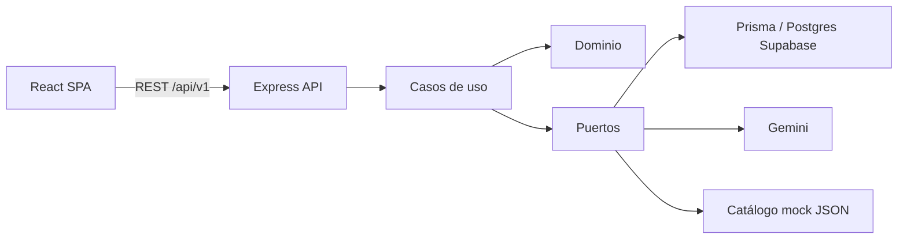
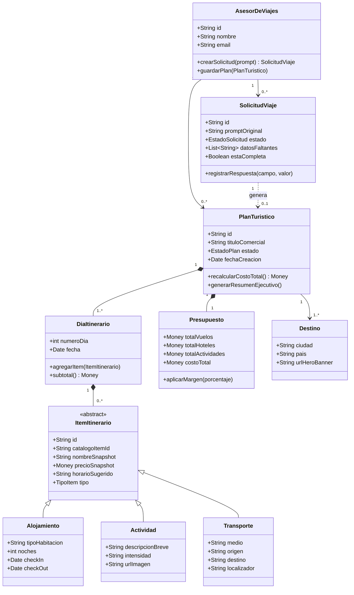
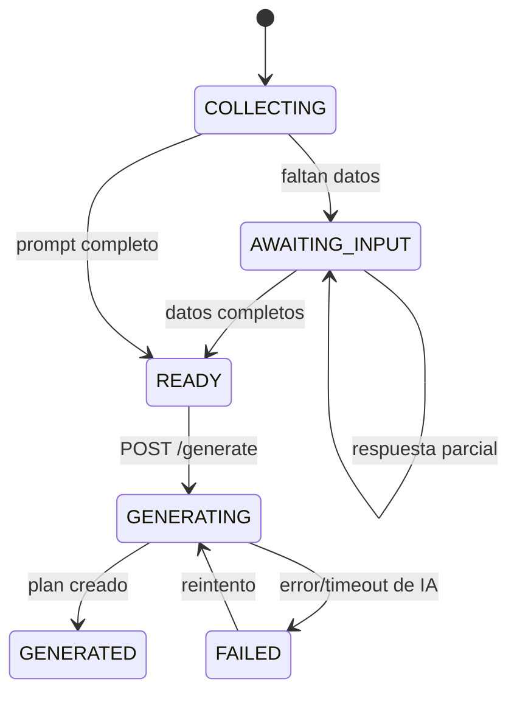
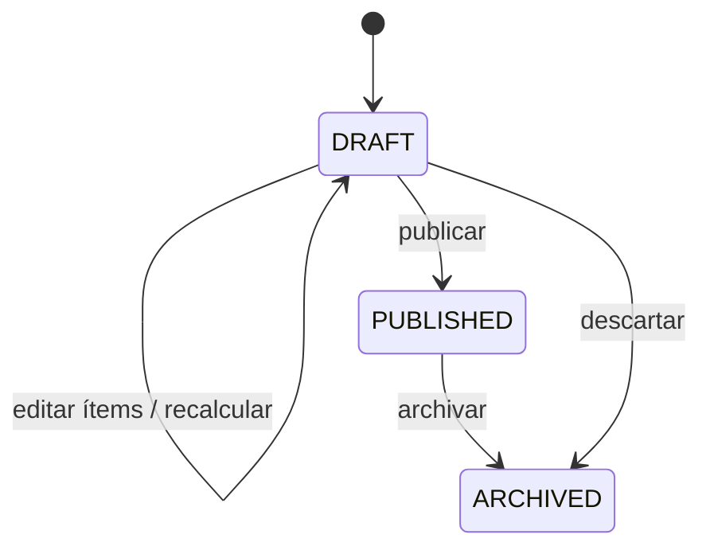
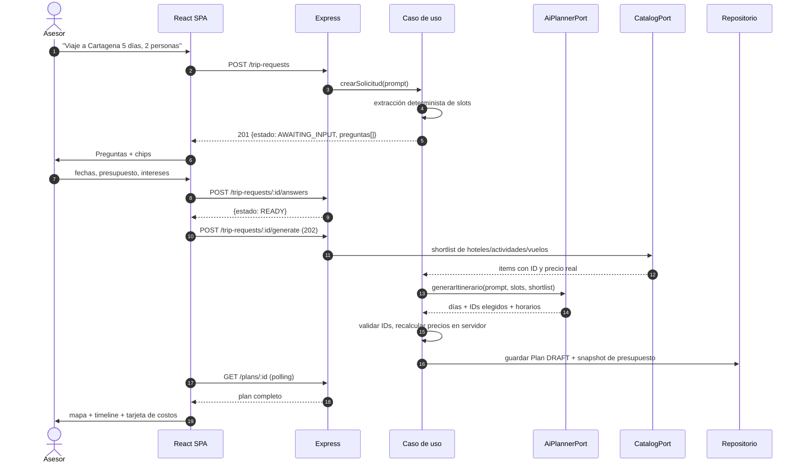
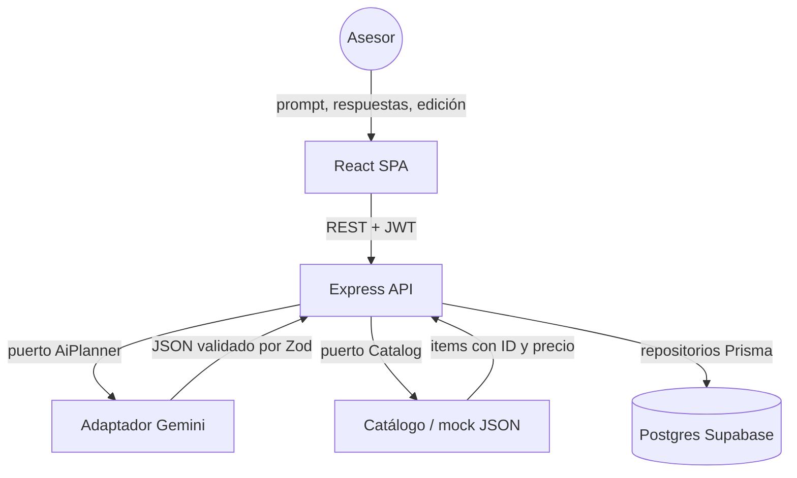

# TuriViajes — Diseñador inteligente de planes turísticos

Módulo 1 de la plataforma de transformación digital de una agencia de turismo: una aplicación web
que convierte una frase en lenguaje natural en un plan turístico completo (destino, alojamiento,
actividades, transporte, itinerario por días, presupuesto y ficha publicable).

La experiencia se inspira en [layla.ai](https://layla.ai/es): sin formularios de búsqueda, un único
*super prompt*, y después un panel dividido (chat a la izquierda, resultados y mapa a la derecha).

> **Estado:** el backend de las fases 0 y 1 ya está implementado (monorepo, configuración validada,
> identidad, RBAC y tests). El frontend y los módulos de catálogo, intake y planificación aún no
> existen. Este README y `AGENTS.md` son la fuente de verdad del producto y del dominio; `docs/`
> contiene arquitectura, contrato de API, modelo de datos, mapa del backend, IA y hoja de ruta. Léelos
> antes de escribir código.

---

## 1. Problema

La agencia ofrece planes nacionales e internacionales, pero la creación de productos turísticos, la
orientación al viajero, la gestión de proveedores y la administración de solicitudes, reservas y
pagos se hacen de forma manual: hojas de cálculo, correos, documentos aislados y conversaciones no
estructuradas. El resultado es reproceso, poca trazabilidad, demoras en la atención e información
desactualizada.

La creación de un plan exige combinar destinos, actividades, alojamiento, transporte, duración,
presupuesto y perfil del viajero. Hecho a mano, una propuesta tarda demasiado y depende de la
experiencia individual del asesor.

## 2. Objetivo

Desarrollar una herramienta funcional para **crear, administrar, consultar y publicar planes
turísticos** nacionales e internacionales, donde la IA apoye la generación de itinerarios a partir de
destino, duración, presupuesto, tipo de viajero e intereses, y donde los costos se calculen sobre un
catálogo estructurado (no sobre texto inventado por el modelo).

### Resultado esperado

Un asesor escribe una frase, responde pocas preguntas, obtiene un borrador editable con itinerario,
mapa y presupuesto desglosado, y lo guarda/publica en la oferta de la agencia.

## 3. Alcance del MVP

**Dentro:**

- Autenticación con roles `ADVISOR` y `ADMIN`; cada asesor ve sus planes.
- Catálogo administrable de destinos, alojamientos, actividades y transporte (Colombia primero,
  internacional después), con precios y disponibilidad básica.
- Intake conversacional: `super prompt` → detección de datos faltantes → preguntas con chips de
  respuesta rápida.
- Generación de itinerario con IA (Gemini configurable) **anclada a IDs del catálogo**.
- Edición por componente: alternativas de hotel/actividad/transporte con recálculo automático.
- Ficha del plan: hero banner, etiquetas de intereses, timeline por días, tarjeta sticky de costos.
- Guardado, listado con filtros, publicación y archivado.
- Mapa interactivo con pines de precio y transporte, y carrusel de destinos sugeridos.
- Reporte básico del plan (JSON/CSV; PDF opcional).

**Fuera (por ahora):** pagos reales, reservas con proveedores, multi-tenant, app móvil, chat libre
sin límites, integración con GDS/amadeus real, facturación electrónica.

## 4. Usuarios y roles

| Rol | Puede |
|---|---|
| `ADVISOR` | Crear solicitudes, generar y editar **sus** planes, publicar, consultar catálogo |
| `ADMIN` | Todo lo del asesor + gestionar usuarios, catálogo y ver todos los planes |
| Público | Nada en el MVP (no hay portal de cliente final) |

## 5. Stack

| Capa | Tecnología | Nota |
|---|---|---|
| Backend | Node.js 22 LTS + Express 5 + TypeScript (strict, ESM) | Sin frameworks que oculten el flujo HTTP |
| Validación | Zod (esquemas compartidos con el frontend) | Una sola fuente para request/response |
| Base de datos | PostgreSQL administrado en Supabase | Solo como Postgres; el acceso pasa por el backend |
| ORM / migraciones | Prisma (`prisma migrate`) | `DATABASE_URL` pooled en runtime, `DIRECT_URL` para migrar |
| IA | Google Gemini detrás de un puerto (`AiPlannerPort`) | `AI_PROVIDER=gemini\|mock`; el mock es obligatorio para tests |
| Frontend | React 19 + Vite + TypeScript | SPA con dos vistas: landing y workspace split-view |
| Estado servidor | TanStack Query | Sin duplicar estado del servidor en stores globales |
| Estado UI | Zustand (solo chat/panel/mapa) | No guardar entidades del backend aquí |
| Mapas | Leaflet + react-leaflet + OpenStreetMap | Sin API key; Mapbox solo si se requiere después |
| Estilos | Tailwind CSS + componentes propios accesibles | Sin librería de UI pesada en el MVP |
| Tests | Vitest + Supertest + Testing Library | Integración contra Postgres real de test |
| Calidad | ESLint (flat) + Prettier + `tsc --noEmit` | Orden: `lint → typecheck → test → build` |

Monorepo con npm workspaces: `backend/`, `frontend/`, `packages/shared/` (tipos y esquemas Zod).

## 6. Arquitectura en 30 segundos

Regla de dependencia: `interfaces → application → domain`; `infrastructure` implementa puertos del
dominio y solo el *composition root* las conecta. Ni Express ni Prisma aparecen en `domain/` ni en
`application/`. Detalle en [`docs/ARCHITECTURE.md`](docs/ARCHITECTURE.md).

## 7. Dominio

### 7.1 Diagrama de clases (conceptual → implementación)

El diagrama original del curso se conserva, con tres ajustes deliberados:

1. `Presupuesto` es un **objeto de valor calculado**, no una tabla; se guarda un *snapshot* de totales
   al generar y al editar.
2. `Destino` se referencia por ID desde el plan (no se embebe), para poder corregir precios y fichas.
3. `SolicitudViaje` (intake) y `PlanTuristico` son **dos agregados con máquinas de estado distintas**.

### 7.2 Estados

**Solicitud (`TripRequest`)** — lo que ve el usuario como "la IA está pensando" se deriva de aquí:

**Plan (`PlanTuristico`)** — `PUBLISHED` es de solo lectura; para cambiarlo se duplica:

> Los estados `AnalisisIA`, `ConsultandoAPIs`, `RecalculandoPresupuesto` del diagrama del curso son
> **transitorios de UI**; no se persisten.

### 7.3 Flujo conversacional y de generación

### 7.4 Comunicación entre componentes

## 8. Historias de usuario (MVP)

### Épica 1 — Interacción centralizada y generación con IA

- **HU 1.1 Super prompt.** Landing minimalista con un input grande, chips de sugerencia
  ("Inspírame", "Último minuto", "Ruta por carretera") y botón "Empezar a planear". Sin formularios.
- **HU 1.2 Completitud dinámica.** Si el prompt no trae destino, fechas/duración, viajeros,
  presupuesto o intereses, el sistema pasa a chat y pregunta **solo lo que falta**, con opciones
  seleccionables. Nunca falla por un prompt incompleto.

### Épica 2 — Visualización y refinamiento

- **HU 2.1 Ficha y resumen.** Hero banner del destino, etiquetas de intereses, tarjeta sticky con
  desglose (vuelos, hotel, actividades, margen) y acción "Guardar plan".
- **HU 2.2 Itinerario por días.** Timeline con pestañas por día; cada ítem muestra horario, nombre e
  imagen/ícono; alojamiento y transporte se distinguen visualmente de las actividades.
- **HU 2.3 Alternativas.** "Cambiar" en un ítem abre 3 alternativas del catálogo; al elegir, el
  presupuesto se recalcula en el servidor y la UI se actualiza.

### Épica 3 — Datos e integración

- **HU 3.1 Catálogo real.** La IA solo puede elegir ítems del catálogo entregado; precios y nombres
  se toman de la base, no del texto del modelo.
- **HU 3.2 Guardado y publicación.** Título comercial obligatorio, persistencia relacional con IDs
  de destino/hotel/actividades/transporte, y dashboard con filtros y reapertura.

Criterios de aceptación detallados por historia: [`docs/ROADMAP.md`](docs/ROADMAP.md).

## 9. Reglas de negocio irrenunciables

1. **Dinero:** enteros en unidades menores (`amountMinor BIGINT`) + `currency CHAR(3)`. Nunca floats.
2. **Precios del servidor:** el precio de un ítem se lee del catálogo al seleccionarlo y se congela
   como *snapshot*. El modelo de IA **no** devuelve precios.
3. **Grounding:** todo ítem generado debe referenciar un `catalogItemId` existente del shortlist.
4. **Propiedad:** un `ADVISOR` solo accede a sus solicitudes y planes; la verificación va en el caso
   de uso, no solo en la ruta.
5. **Publicación:** requiere título comercial y al menos un día con ítems; `PUBLISHED` es inmutable.
6. **Moneda:** un plan tiene una sola moneda; no se mezclan COP y USD en el mismo plan.

## 10. Documentación

| Archivo | Contenido |
|---|---|
| [`AGENTS.md`](AGENTS.md) | Reglas operativas para agentes (leer primero) |
| [`docs/ARCHITECTURE.md`](docs/ARCHITECTURE.md) | Capas, módulos, seguridad, IA, configuración |
| [`docs/DOMAIN.md`](docs/DOMAIN.md) | Modelo de datos, invariantes, cálculo de presupuesto |
| [`docs/API.md`](docs/API.md) | Contrato REST, errores, paginación, RBAC |
| [`docs/ROADMAP.md`](docs/ROADMAP.md) | Fases incrementales y definición de terminado |

## 11. Cómo se construye

Entrega **incremental por rebanadas verticales**: cada sección añade dominio + caso de uso +
adaptador + ruta + tests + actualización de docs. No se genera la app completa de una vez y no se
hace `git commit` sin autorización explícita del usuario.
