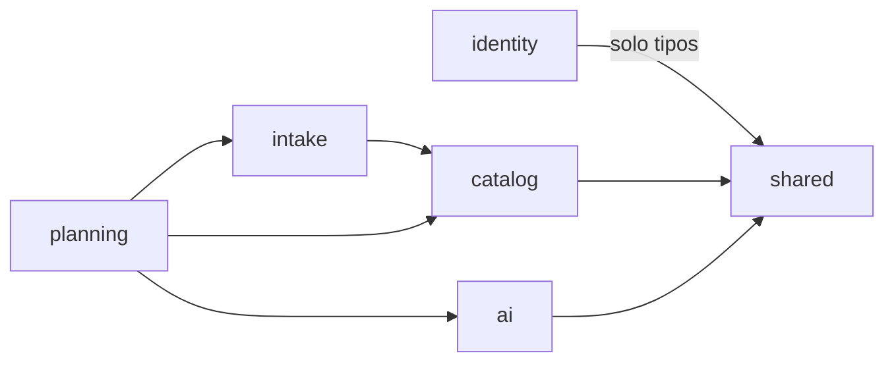
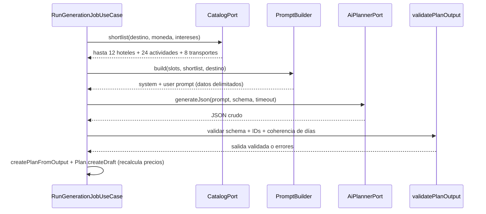

# Arquitectura — Trazo

Documento de referencia de la arquitectura implementada. Complementa [`../README.md`](../README.md),
[`DOMAIN.md`](DOMAIN.md), [`BACKEND.md`](BACKEND.md) (mapa real del backend), [`AI.md`](AI.md)
(configuración de Gemini y grounding) y [`DEPLOYMENT.md`](DEPLOYMENT.md) (Supabase + Vercel). Si algo
aquí no coincide con el código, se corrige el documento.

> **Estado:** backend de las fases 0–7 implementado. El frontend tiene login, guards, cliente API y
> refresh; las pantallas de negocio, la disponibilidad de catálogo (HU 3.3–3.4) y el clima (HU 2.6)
> siguen pendientes.

## 1. Principios

1. **Arquitectura limpia / hexagonal.** El dominio no sabe de HTTP, SQL ni LLMs.
2. **Puertos y adaptadores.** Todo servicio externo (Postgres, Gemini, catálogo, almacenamiento) entra
   por una interfaz declarada en `domain/ports/`.
3. **Casos de uso como unidad de entrega.** Cada endpoint es un caso de uso con su test.
4. **Seguro por defecto.** Validación en el borde, autorización en el caso de uso, secretos por entorno.
5. **Degradación controlada.** Sin API key de IA la app funciona con `AI_PROVIDER=mock` (útil en demo y tests).

## 2. Capas

| Capa | Contiene | Puede importar |
|---|---|---|
| `domain` | Entidades, value objects (`Money`, `DateRange`, `Budget`), reglas, puertos, errores de dominio | Nada externo |
| `application` | Casos de uso, DTOs de entrada/salida, orquestación, validación de salida de IA | `domain` |
| `infrastructure` | Prisma, Gemini, catálogo JSON/API, argon2, JWT, pino, storage | `domain`, `application` |
| `interfaces/http` | Routers, controllers, middlewares, mappers a JSON | `application`, `domain` (tipos) |
| `config` | Env validado, composition root | Todas |

**Regla:** las dependencias apuntan hacia el dominio. `application` recibe puertos por constructor.

```ts
// application/planning/update-plan.use-case.ts
export class UpdatePlanUseCase {
  constructor(
    private readonly plans: PlanRepository,
    private readonly destinations: DestinationRepository,
    private readonly clock: Clock,
  ) {}
}
```

## 3. Módulos (bounded contexts)



| Módulo | Responsabilidad | Entidades |
|---|---|---|
| `identity` | Usuarios, login, tokens, roles | `User`, `RefreshToken` |
| `catalog` | Destinos, hoteles, actividades, transporte, precios, imágenes | `Destination`, `Hotel`, `Activity`, `TransportOption` |
| `intake` | Solicitud de viaje, slots, preguntas y refinamiento conversacional | `TripRequest` |
| `planning` | Generación, edición, presupuesto, publicación, dashboard | `Plan`, `PlanDay`, `PlanItem` |
| `ai` | Puertos de IA, construcción de prompts, validación de salida, adaptadores | — |

`intake` está implementado con un parser determinista y sin IA. `planning` y `ai` están implementados
desde la Fase 4: `planning` orquesta shortlist, generación, validación, recálculo y ciclo de vida; `ai`
expone el puerto `AiPlannerPort`, los adaptadores Gemini/mock y la validación de la salida. `planning`
no expone entidades de `catalog` al frontend: usa DTOs con los campos necesarios.

## 4. Ciclo de una petición HTTP

```
requestId → helmet → cors → json(100kb) → rateLimit → auth(JWT) → zod(validate) → controller
  → use case → repository/port → presenter → response
                                  ↘ AppError → errorHandler (problem+json)
```

- Un controller **solo** traduce HTTP ↔ caso de uso (sin reglas de negocio).
- Los errores de dominio se mapean a códigos HTTP en un único `errorHandler`.
- `GET /health` (liveness) y `GET /health/ready` (solo comprueba la DB con `SELECT 1`) sin auth. La
  disponibilidad de Gemini no bloquea el arranque ni el readiness: si falla, el job queda `FAILED` con
  `AI_UNAVAILABLE` y se puede reintentar.

### Modelo de errores

`application/problem+json` (RFC 9457) con `type`, `title`, `status`, `detail`, `code`, `requestId` y
`errors[]` para validación.

| `code` | HTTP | Cuándo |
|---|---|---|
| `VALIDATION_ERROR` | 422 | Zod o regla de negocio de entrada |
| `UNAUTHENTICATED` | 401 | Token ausente/expirado |
| `FORBIDDEN` | 403 | Rol u ownership |
| `NOT_FOUND` | 404 | Recurso inexistente o ajeno (no filtrar existencia) |
| `CONFLICT` | 409 | Estado incompatible (p. ej. editar `PUBLISHED`) |
| `PLAN_NOT_EDITABLE` | 409 | Intento de mutar un plan `PUBLISHED`/`ARCHIVED` |
| `RATE_LIMITED` | 429 | Límite superado |
| `AI_UNAVAILABLE` | 503 | Timeout/cuota del proveedor |
| `AI_INVALID_OUTPUT` | 502 | El modelo no produjo JSON válido tras reparación |

## 5. Persistencia

- Prisma como único acceso a datos; **cero SQL concatenado**.
- Repositorios en `infrastructure/persistence/prisma/*.repository.ts` implementan puertos del dominio
  y mapean filas → entidades (nada de `PrismaClient` fuera de infraestructura).
- Las escrituras compuestas usan `$transaction` cortas dentro del repositorio (por ejemplo, guardar un
  plan reemplaza días e ítems en una transacción). La generación de IA ocurre **fuera** de cualquier
  transacción; el plan se persiste al final, cuando la salida ya está validada.
- Migraciones versionadas en `backend/prisma/migrations/`; nunca `db push` en entornos compartidos.
- `deletedAt` (soft delete) solo en `Plan`/`TripRequest`; catálogo usa `isActive`.
- Índices mínimos: `plans(advisor_id, status)`, `plan_items(plan_day_id)`, `hotels(destination_id)`,
  `activities(destination_id)`, `trip_requests(advisor_id, status)`, `refresh_tokens(user_id)`.

### 5.1 Imágenes y Supabase Storage

- El puerto `domain/storage/ports.ts` (`ObjectStorage`) abstrae el almacenamiento; el adaptador
  `infrastructure/storage/supabase-storage.ts` usa la API REST de Supabase Storage con `fetch`, sin
  SDK adicional.
- Bucket público `catalog`. El seed crea el bucket y sube los WebP locales con `x-upsert: true`; si
  Storage no está configurado, usa `picsum.photos` como fallback de desarrollo.
- La `service_role` solo se usa en el backend (seed/jobs operativos). El frontend recibe únicamente
  URLs públicas (`heroImageUrl` / `imageUrl`) a través de la API.
- No hay endpoint de subida de archivos en esta fase: las imágenes se cargan por seed o se editan como
  URL en el catálogo. Una galería múltiple requeriría una tabla `catalog_images` (fuera de alcance).

## 6. Generación con IA



Reglas:

- Salida estructurada (JSON Schema) validada con Zod. Una sola reparación automática; luego `AI_INVALID_OUTPUT`.
- **Grounding obligatorio:** los IDs devueltos deben pertenecer al shortlist enviado; precios y nombres
  salen de la BD. Un ID desconocido invalida el ítem, no todo el plan; un día no puede quedar vacío.
- Límites: `AI_TIMEOUT_MS` (45 s), máx. 30 días y 6 ítems/día, 8 000 tokens de salida.
- Determinismo para tests: `AI_PROVIDER=mock`; los tests HTTP usan `MockPlanner` y fakes, sin red.
- **Sin caché de shortlist en el MVP:** se recalcula por generación para no usar precios viejos. No se
  cachean planes ni respuestas completas del modelo.
- Loggear `model`, `latencyMs`, `tokens`, `outcome`; nunca el prompt completo en producción.
- Ejecución asíncrona: `POST /generate` responde `202`, el trabajo se persiste en `ai_jobs` y un runner
  in-process lo procesa; el cliente hace polling del `TripRequest`. Sin Redis en el MVP. Para varias
  instancias hace falta una cola real (ver [`DEPLOYMENT.md`](DEPLOYMENT.md#11-por-qué-no-todo-en-vercel)).

## 7. Seguridad

### Autenticación

- `argon2id` para contraseñas (mín. 12 caracteres). Nunca `md5/sha1`.
- Access JWT (15 min, `sub`, `role`, `iat`, `exp`) en memoria; refresh opaco rotativo (7 días) en
  cookie `HttpOnly; SameSite=Strict; Path=/api/v1/auth` (`Secure` en producción), guardado como hash
  SHA-256 con `familyId` para detectar reuso.
- Reuso de refresh ⇒ revocar familia y forzar login.
- `POST /auth/logout` revoca el refresh actual. Sin registro público: `ADMIN` crea asesores.

### Autorización

- Middleware `requireAuth` + `requireRole(...)`; el caso de uso recibe `actor { id, role }` y valida
  ownership. Un `ADVISOR` nunca pasa `advisorId` como parámetro de confianza.
- Matriz de permisos en [`API.md`](API.md#rbac).

### Superficie de ataque

- CORS con allowlist exacta, `credentials: true` solo para el origen del SPA.
- Rate limit: `auth` 5/min/IP, `generate` 10/h/usuario, global 300/min/IP.
- Validación Zod con `.strict()`; rechazar campos desconocidos en payloads sensibles.
- Sanitizar texto mostrado (React escapa por defecto; no usar `dangerouslySetInnerHTML`).
- Prompt injection: instrucciones del sistema separadas, entrada delimitada, salida solo por schema,
  y ninguna acción con efectos (publicar, borrar) disparada por el modelo.
- Dependencias: `npm audit` en CI; lockfile commitido.
- Uploads (fase posterior): validar MIME real, ≤ 5 MB, nombres aleatorios, bucket privado + URLs firmadas.

## 8. Frontend

- Rutas: `/` (landing), `/workspace/:tripRequestId` (split-view), `/plans` (dashboard), `/plans/:id`,
  `/login`. Guard de sesión en `app/router`.
- Split-view: panel izquierdo = chat + chips + estado ("La IA está pensando…"); derecho = mapa +
  carrusel superpuesto + timeline. El estado del chat vive en Zustand; los datos del plan en TanStack Query.
- El "thinking" se deriva de `tripRequest.status ∈ {GENERATING}`; no simular progreso falso.
- Accesibilidad: foco visible, `aria-live` para mensajes del asistente, navegación por teclado en chips,
  contraste AA. El mapa tiene lista alternativa accesible.
- El token de acceso nunca se persiste; al recargar se restaura sesión con `POST /auth/refresh`.
- Código de mapa en `lazy()` para evitar `window` en SSR/tests.

## 9. Configuración

Validada con Zod al arrancar; si falta una variable requerida, el proceso no inicia.

| Variable | Requerida | Ejemplo / nota |
|---|---|---|
| `NODE_ENV` | no | `development` \| `test` \| `production` |
| `PORT` | no | `3000` |
| `CORS_ORIGINS` | no | `http://localhost:5173` (lista separada por comas) |
| `TRUST_PROXY` | no | `false`; `true` solo detrás de proxy de confianza |
| `DATABASE_URL` | sí | pooler Supabase `:6543?pgbouncer=true` |
| `DIRECT_URL` | sí | `:5432`, solo migraciones/seed |
| `JWT_ACCESS_SECRET` | sí | ≥ 32 bytes aleatorios |
| `ACCESS_TOKEN_TTL_SECONDS` | no | `900` (15 min) |
| `REFRESH_TOKEN_TTL_DAYS` | no | `7` |
| `COOKIE_DOMAIN` | no | vacío; solo si SPA y API comparten dominio padre |
| `AI_PROVIDER` | no | `mock` (default) \| `gemini` |
| `GEMINI_API_KEY` | si `gemini` | nunca en el repo |
| `GEMINI_MODEL` | no | `gemini-3-flash-preview` |
| `AI_TIMEOUT_MS` | no | `45000` |
| `LOG_LEVEL` | no | `info` |
| `RATE_LIMIT_ENABLED` | no | `true`; `false` solo en tests |
| `ADMIN_NAME` | no | `Administrador` (seed) |
| `ADMIN_EMAIL` | si seed | email del admin |
| `ADMIN_PASSWORD` | si seed | mínimo 12 caracteres |

El backend carga **`backend/.env`** (no el `.env` de la raíz). `.env.example` documenta todos los
campos; nunca se commitea un `.env` real.

## 10. Testing

| Nivel | Herramienta | Qué cubre |
|---|---|---|
| Dominio | Vitest | Invariantes, `Money`, presupuesto, transiciones de estado |
| Casos de uso | Vitest + fakes | Orquestación, autorización, grounding |
| API | Supertest + repositorios en memoria (Postgres de test pendiente) | Contratos, códigos de error, RBAC |
| Adaptador IA | Vitest + fixtures | Parseo, reparación, IDs inválidos, timeout |
| Frontend | Testing Library | Flujo de preguntas, alternativas, estados de carga |

Cobertura objetivo: dominio y casos de uso ≥ 85 %; no perseguir cobertura en controllers.

## 11. Decisiones (ADR-lite)

| # | Decisión | Motivo | Consecuencia |
|---|---|---|---|
| 1 | Express + TS en capas limpias | Requisito del equipo; control explícito del flujo | Wiring manual en `config/container.ts` |
| 2 | Supabase solo como Postgres | Evita acoplar auth/lógica a un vendor | Auth propio con JWT; RLS no se usa |
| 3 | Prisma | Migraciones y tipos productivos | `DIRECT_URL` obligatoria para migrar |
| 4 | Gemini tras `AiPlannerPort` | Proveedor reemplazable y tests offline | Hay que mantener el adaptador `mock` |
| 5 | Grounding por `catalogItemId` | Evita alucinaciones de precio | Shortlist previo a cada generación |
| 6 | Generación asíncrona con `ai_jobs` | LLM > 20 s; no bloquear HTTP | Cliente hace polling; worker in-process |
| 7 | Leaflet + OSM | Sin API key ni costo | Estilo de mapa más básico que Mapbox |
| 8 | Dinero en enteros menores | Evita errores de redondeo | Formateo solo en el borde |
| 9 | Parser determinista antes de la IA | Slots simples se resuelven sin costo ni latencia y son testeables offline | La IA de la Fase 4 solo se usa para ambigüedad y generación, nunca para precios |
