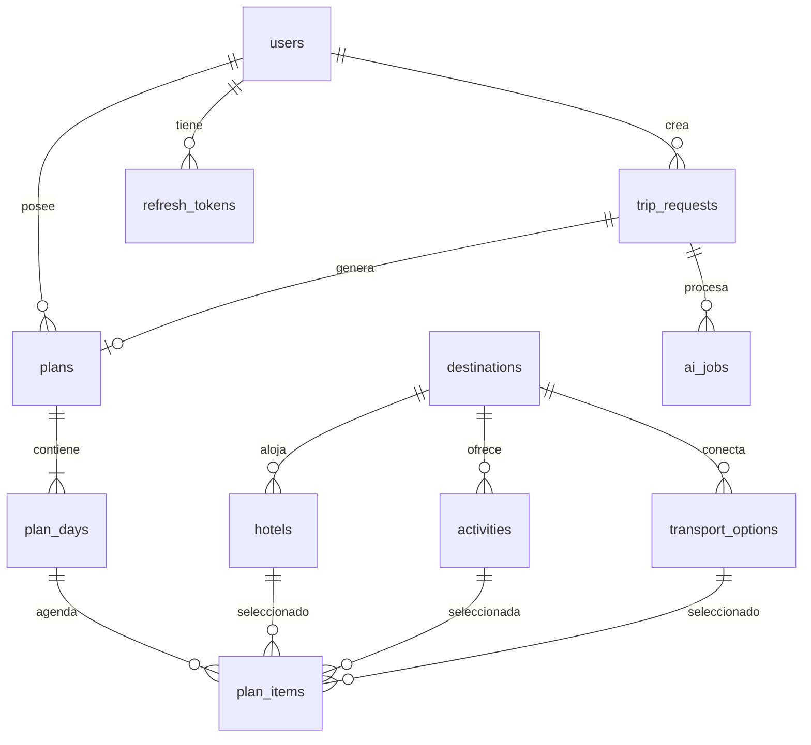

# Dominio y modelo de datos — TuriViajes

Fuente de verdad del modelo relacional, el lenguaje ubicuo y las invariantes. Cualquier cambio de
esquema se refleja aquí y en `backend/prisma/schema.prisma` en el mismo cambio.

## 1. Lenguaje ubicuo

| Término de negocio | Código | Notas |
|---|---|---|
| Asesor de viajes | `User` (`role = ADVISOR`) | Único actor del MVP |
| Solicitud de viaje | `TripRequest` | Intake conversacional; agregado propio |
| Plan turístico | `Plan` | Agregado raíz de la oferta |
| Día de itinerario | `PlanDay` | `dayNumber` 1..N |
| Ítem de itinerario | `PlanItem` | Alojamiento, actividad o transporte |
| Ficha descriptiva | `Plan` + `Destination` + snapshot | Vista, no entidad |
| Presupuesto | Value object `Budget` | Calculado; se persiste snapshot |
| Alternativa | `CatalogAlternative` (DTO) | Ítems del mismo tipo y destino |
| Datos faltantes | `missingFields` | Slots requeridos sin resolver |

## 2. Entidades

Convenciones: `id uuid` (generado por `gen_random_uuid()`), `created_at/updated_at timestamptz`,
`currency char(3)`, dinero en `*_minor bigint`. Nombres de tabla en `snake_case` plural.

### identity

**users**

| Campo | Tipo | Regla |
|---|---|---|
| `id` | uuid PK | |
| `name` | text | 2–120 |
| `email` | citext UNIQUE | normalizado a minúsculas |
| `password_hash` | text | argon2id |
| `role` | enum | `ADVISOR` \| `ADMIN` |
| `is_active` | boolean | default true |
| `last_login_at` | timestamptz | nullable |

**refresh_tokens**

| Campo | Tipo | Regla |
|---|---|---|
| `id` | uuid PK | |
| `user_id` | uuid FK → users | `ON DELETE CASCADE` |
| `token_hash` | text UNIQUE | SHA-256 del token opaco |
| `family_id` | uuid | rotación; reuso revoca la familia |
| `expires_at` | timestamptz | |
| `revoked_at` | timestamptz | nullable |
| `replaced_by_id` | uuid | nullable, auto-FK |

### catalog

**destinations**: `id`, `city`, `country`, `slug` UNIQUE, `description`, `hero_image_url`,
`latitude numeric(9,6)`, `longitude numeric(9,6)`, `timezone` (default `America/Bogota`),
`tags text[]` (p. ej. `ciudad-amurallada`, `vida-nocturna`), `is_featured` (default false), `is_active`.
Índice `(country, is_active)`, búsqueda por `city` con `pg_trgm`. `fromPriceMinor` **no se almacena**:
se deriva con `MIN(price_per_night_minor)` de los hoteles activos y se usa en los pines del mapa.

**hotels**: `id`, `destination_id` FK, `name`, `description`, `category smallint` (1–5),
`room_type`, `price_per_night_minor`, `currency`, `image_url`, `amenities jsonb`, `is_active`.
Índice `(destination_id, is_active, price_per_night_minor)`.

**activities**: `id`, `destination_id` FK, `name`, `description`, `intensity enum(LOW|MEDIUM|HIGH)`,
`duration_minutes`, `price_per_person_minor`, `currency`, `image_url`, `tags text[]` (intereses),
`is_active`. Índice GIN en `tags`, índice `(destination_id, is_active)`.

**transport_options**: `id`, `origin_destination_id` (nullable, FK), `destination_id` FK,
`mode enum(FLIGHT|BUS|CAR_RENTAL|BOAT|TRAIN)`, `provider`, `price_minor`, `currency`,
`pricing_unit enum(PER_PERSON|PER_NIGHT|PER_DAY|PER_TRIP)`, `duration_minutes`, `is_active`.
`CAR_RENTAL` usa `PER_DAY`; `FLIGHT` usa `PER_TRIP` o `PER_PERSON` según tarifa.

### planning

**trip_requests**

| Campo | Tipo | Regla |
|---|---|---|
| `id` | uuid PK | |
| `advisor_id` | uuid FK → users | dueño; nunca viene del cliente |
| `prompt_original` | text | 1–2000 chars |
| `status` | enum | `COLLECTING`\|`AWAITING_INPUT`\|`READY`\|`GENERATING`\|`GENERATED`\|`FAILED` |
| `extracted_slots` | jsonb | salida cruda del parser (auditoría) |
| `missing_fields` | text[] | slots pendientes |
| `destination_id` | uuid FK | nullable hasta resolver |
| `start_date` | date | nullable |
| `end_date` | date | nullable |
| `duration_days` | smallint | 1–30 |
| `adults` | smallint | ≥ 1 |
| `children` | smallint | ≥ 0 |
| `traveler_type` | enum | `SOLO`\|`COUPLE`\|`FAMILY`\|`FRIENDS`\|`BUSINESS` |
| `interests` | text[] | p. ej. `playa`, `cultura`, `aventura` |
| `budget_min_minor` | bigint | nullable |
| `budget_max_minor` | bigint | nullable |
| `currency` | char(3) | default `COP` |
| `error_code` | text | nullable, solo en `FAILED` |

Regla: `start_date`/`end_date` y `duration_days` son consistentes (`end = start + duration - 1`).

**plans**

| Campo | Tipo | Regla |
|---|---|---|
| `id` | uuid PK | |
| `trip_request_id` | uuid UNIQUE FK | 1:1 con la solicitud origen |
| `advisor_id` | uuid FK | copiado de la solicitud |
| `destination_id` | uuid FK | destino principal |
| `title` | text | requerido para publicar (3–120) |
| `status` | enum | `DRAFT`\|`PUBLISHED`\|`ARCHIVED` |
| `summary` | text | resumen ejecutivo generado/editable |
| `hero_image_url` | text | |
| `tags` | text[] | intereses detectados |
| `currency` | char(3) | una sola por plan |
| `subtotal_minor` | bigint | suma de ítems |
| `margin_percent` | numeric(5,2) | 0–50, default de la agencia |
| `margin_minor` | bigint | calculado |
| `total_minor` | bigint | `subtotal + margin` |
| `version` | integer | incrementa al duplicar |
| `published_at` | timestamptz | nullable |
| `deleted_at` | timestamptz | soft delete |

**plan_days**: `id`, `plan_id` FK `ON DELETE CASCADE`, `day_number smallint`, `date date`, `title`,
`notes`, UNIQUE `(plan_id, day_number)`.

**plan_items**: `id`, `plan_day_id` FK CASCADE, `type enum(ACCOMMODATION|ACTIVITY|TRANSPORT)`,
`hotel_id` / `activity_id` / `transport_option_id` (nullable FKs), `name_snapshot text`,
`unit_price_minor bigint`, `quantity smallint`, `pricing_unit`, `subtotal_minor bigint`,
`start_time time`, `end_time time`, `notes`, `position smallint`.

CHECK: exactamente una FK de catálogo no nula y coherente con `type`.

**ai_jobs**: `id`, `trip_request_id` FK, `status enum(QUEUED|RUNNING|SUCCEEDED|FAILED)`,
`attempts smallint`, `model`, `latency_ms`, `tokens_in`, `tokens_out`, `error_code`, `started_at`,
`finished_at`.

## 3. Diagrama entidad-relación



## 4. Invariantes

| ID | Invariante |
|---|---|
| INV-01 | Todo monto es entero en unidades menores + moneda; no hay floats en precios. |
| INV-02 | Un plan usa una sola moneda; si el catálogo no coincide, se descarta el ítem. |
| INV-03 | `total = subtotal + margin`; `margin` se redondea una sola vez a nivel de plan (half-up). |
| INV-04 | `plan_item.subtotal = unit_price_snapshot * quantity` (cantidad = noches, personas o días). |
| INV-05 | Todo `plan_item` referencia un ítem de catálogo existente; el nombre y precio son *snapshot* al momento de seleccionar. |
| INV-06 | La IA solo puede devolver `catalogItemId` del shortlist; IDs fuera de él se descartan. |
| INV-07 | Un `Plan` nace `DRAFT`; `PUBLISHED` no admite mutaciones (duplicar para editar). |
| INV-08 | Publicar exige `title`, ≥ 1 `PlanDay` con ≥ 1 `PlanItem` y total > 0. |
| INV-09 | Un `ADVISOR` solo accede a solicitudes/planes con su `advisor_id`; `ADMIN` accede a todos. |
| INV-10 | `TripRequest.READY` exige destino, fechas/duración, viajeros y presupuesto; intereses son opcionales. |
| INV-11 | No se puede generar dos veces sobre la misma solicitud sin cerrar el job anterior (`409`). |
| INV-12 | `day_number` es consecutivo desde 1 y su `date` respeta `start_date`. |

## 5. Cálculo de presupuesto

```
item.subtotal   = item.unitPriceMinor × item.quantity
day.subtotal    = Σ item.subtotal
plan.subtotal   = Σ day.subtotal
plan.margin     = roundHalfUp(plan.subtotal × marginPercent / 100)
plan.total      = plan.subtotal + plan.margin
```

- `quantity` por tipo: alojamiento = noches; actividad = viajeros (adultos + niños); transporte
  `PER_DAY` = días de alquiler; `PER_TRIP` = 1; `PER_PERSON` = viajeros.
- El alojamiento se registra **una sola vez**, en el día de check-in, con `quantity = noches` y
  `subtotal = precio_noche × noches`. Por eso el `subtotal` de ese día incluye toda la estadía; la UI
  lo muestra como tarjeta que abarca los días. No crear un ítem de hotel por noche.
- El margen de agencia se aplica **una vez** al total, nunca por ítem (evita acumulación de redondeo).
- `marginPercent` se congela en el plan al crearlo; cambiarlo es una acción explícita de `ADMIN`.
- Recalcular es una operación de servidor; el cliente nunca envía totales.

## 6. Intake: slots y preguntas

Orden de resolución (determinista primero, IA solo para ambigüedad):

1. `destination` — match contra `destinations.city/slug` (trigram).
2. `duration` — fechas explícitas o "N días"; si solo hay fechas, derivar días.
3. `travelers` — "2 adultos", "pareja", "familia con 2 niños".
4. `budget` — rango explícito o banda (`LOW`/`MEDIUM`/`HIGH`) → min/max en moneda del destino.
5. `interests` — tags del catálogo; opcional, default según `traveler_type`.

| Slot faltante | Pregunta | Chips |
|---|---|---|
| `destination` | ¿A dónde quieren viajar? | Cartagena y playa · Eje Cafetero · Sorpréndenos |
| `duration` | ¿Cuántos días y en qué fechas? | Fin de semana · 5 días · 10 días |
| `travelers` | ¿Quiénes viajan? | Pareja · Familia · Amigos · Solo |
| `budget` | ¿Qué presupuesto manejan por persona? | Económico · Medio · Premium |
| `interests` | ¿Qué tipo de experiencia buscan? | Playa · Cultura · Aventura · Gastronomía |

Máximo 2 preguntas por turno. `Sorpréndenos` resuelve destino con el top de destinos activos.

## 7. Alternativas

- Solo del mismo `type`, mismo `destination_id` y misma moneda; se excluye el ítem actual.
- Se ordenan por cercanía al precio actual y se devuelven 3.
- Al elegir: se actualiza la FK, el snapshot de nombre/precio, `quantity` si aplica, y se recalcula el
  plan completo dentro de una transacción corta.
- El plan debe estar `DRAFT`; si está `PUBLISHED`, responder `409 CONFLICT`.
